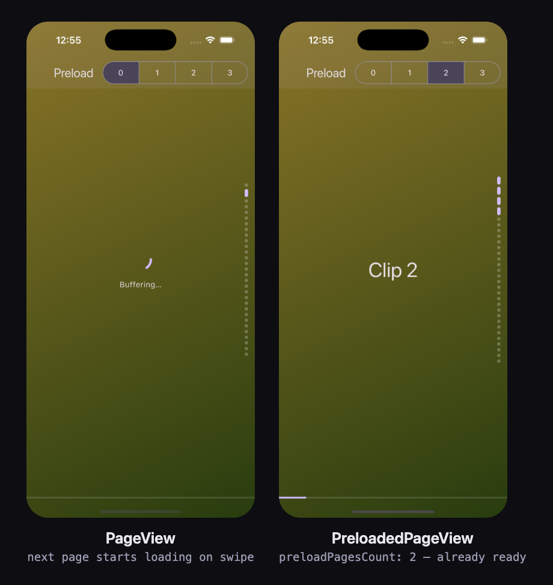

# preloaded_page_view

[](https://pub.dev/packages/preloaded_page_view)
[](https://github.com/ManukumarSB/preloaded_page_view/actions/workflows/ci.yml)

A `PageView` that builds the next and previous pages before you swipe to
them, so a video has already buffered or an image has already decoded by the
time it's on screen.

Flutter's `PageView` only ever builds what's visible (or one extra page with
`allowImplicitScrolling`). There's a [TODO in the framework](https://github.com/flutter/flutter/issues/45632)
for this and an [open issue](https://github.com/flutter/flutter/issues/31191)
with 130+ upvotes. This package fills the gap using the same building blocks
`PageView` does, with no dependencies.



## Install

```sh
flutter pub add preloaded_page_view
```

## Usage

```dart
import 'package:preloaded_page_view/preloaded_page_view.dart';

PreloadedPageView.builder(
  preloadPagesCount: 2,
  itemCount: videos.length,
  itemBuilder: (context, index) => VideoPage(videos[index]),
)
```

With `preloadPagesCount: 2` and the user on page 5, pages 3 to 7 are built and
kept alive. Swipe to 6 and page 3 is disposed while 8 starts building. It's
exactly N pages on each side, also with `viewportFraction` and `padEnds`.

It takes a normal `PageController`, so `animateToPage`, `jumpToPage` and page
indicator packages work as they do with `PageView`. Every `PageView` option
you'd expect is there: `scrollDirection`, `reverse`, `physics`,
`pageSnapping`, `onPageChanged`, `padEnds`, `clipBehavior` and so on.

### Only play the page on screen

Preloading a video is only half the job — you don't want three of them
playing at once. Ask from inside the page whether it's the current one:

```dart
@override
Widget build(BuildContext context) {
  final isCurrent = PreloadedPageView.isCurrentPage(context);
  isCurrent ? _controller.play() : _controller.pause();
  return VideoPlayer(_controller);
}
```

When the page changes, only the page that left and the page that arrived
rebuild. The other preloaded pages aren't touched.

`PreloadedPageView.indexOf(context)` gives you the page's index if you need it.

## How many pages to preload

Each preloaded page is fully built and laid out, so it costs memory like a
visible one. For video feeds `1` or `2` is plenty. For lightweight pages like
images or text you can go higher. `0` behaves like a plain `PageView`.

## Coming from preload_page_view

[preload_page_view](https://pub.dev/packages/preload_page_view) hasn't been
updated since 2023 and works by copying an old version of `PageView`'s source.
Switching over is mostly a rename:

```dart
// before
PreloadPageView.builder(
  preloadPagesCount: 2,
  controller: PreloadPageController(),
  itemBuilder: ...,
)

// after
PreloadedPageView.builder(
  preloadPagesCount: 2,
  controller: PageController(),
  itemBuilder: ...,
)
```

## Things to know

- Preloading goes both ways — the pages behind you stay alive too. Flutter's
  viewport has one cache size for both directions.
- `isCurrentPage` and `indexOf` work for pages built with the default and
  `.builder` constructors. With `.custom` you bring your own delegate, so
  they return false/null.
- Screen readers can move focus onto preloaded pages and the view scrolls to
  them, same as `PageView` with `allowImplicitScrolling`.

## Contributing

Issues and PRs are welcome. Please run `flutter analyze` and `flutter test`
before opening a PR.
